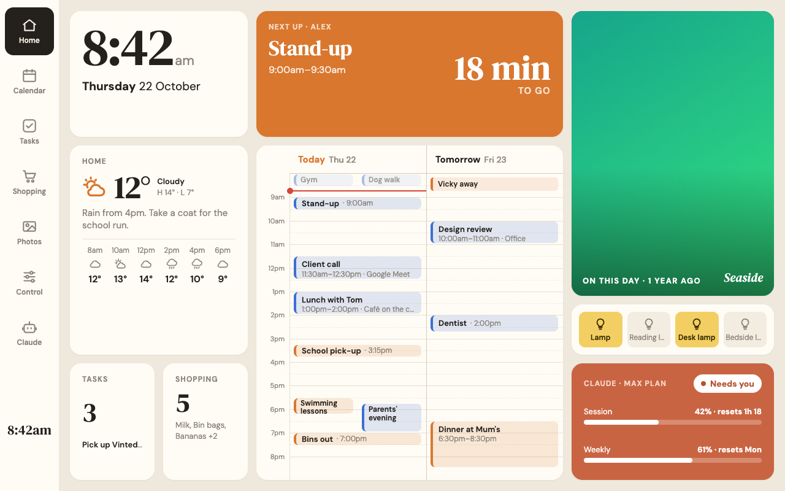
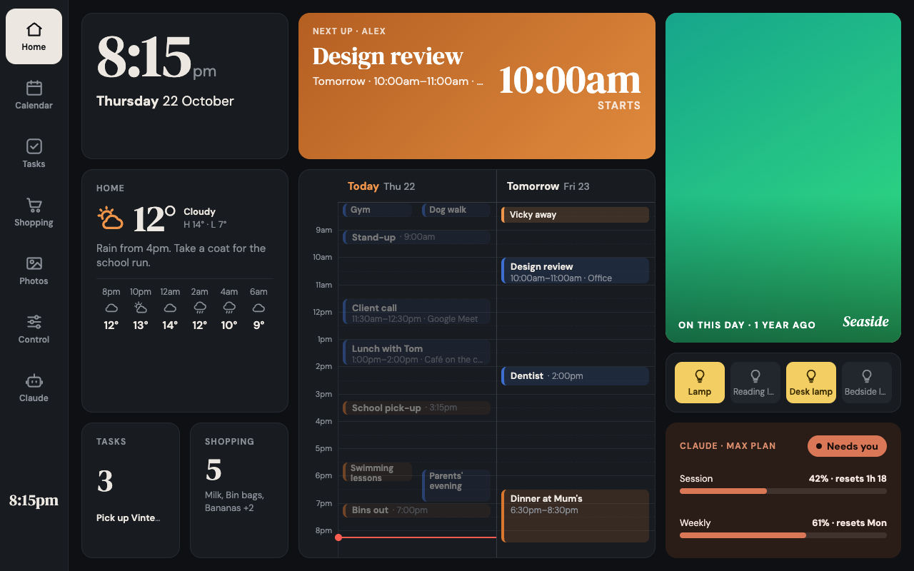
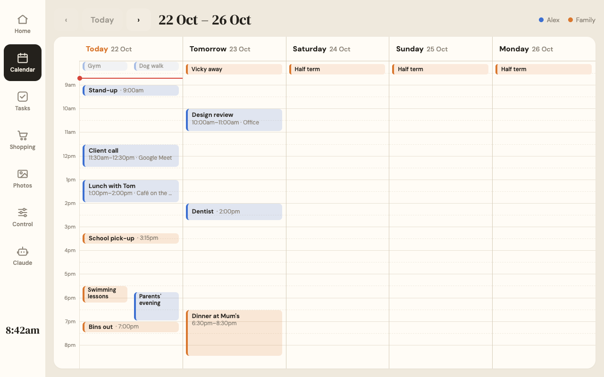

# Photo frame family dashboard

A wall dashboard for a cheap Android photo frame. Once the frame's vendor software is removed, it shows a single full-screen page: the time, the next event with a "leave by" reminder, today and tomorrow on a proper calendar grid, the weather, a rotating family photo, the lamps, the shopping list, the family task board, and whether a Claude Code session is waiting for me. By day it uses a warm "paper" theme; after sunset it fades to a dark one, dims in the evening and switches itself off overnight.



This project builds on Wes Bos's [photo-frame-dashboard](https://github.com/wesbos/photo-frame-dashboard) ([video](https://www.youtube.com/watch?v=ZLycoUMltNI)). His repository documents how to unlock these frames, and its kiosk app will show this dashboard full screen. The dashboard itself is a new build wired to real household services rather than mock data.

## Status

The dashboard front end is complete and runs on a Mac against a mock version of the home server's API. Next come the home server (a Raspberry Pi), unlocking the frame itself, and two small helpers on the Mac. Work in progress.

| Piece | State |
| --- | --- |
| Dashboard front end (this repo's `dashboard/`) | Done, running against mock data |
| Home server on a Raspberry Pi | Planned |
| Unlocking the frame (Humblestead 10.1", PF1007L board) | Planned |
| Mac helpers (activity-based screen sleep, Claude Code status) | Planned |

## How it fits together

The frame runs only a full-screen web page and holds no passwords. A Raspberry Pi on the home network does the real work: it reads Google Calendar through private iCal links, syncs a Google Keep shopping list both ways, keeps the family task list, serves photos from a Google Drive folder, switches TP-Link Tapo smart plugs and controls a Nest speaker on the local network. A small helper on my Mac tells the Pi when I'm at my desk, so the frame switches off when I'm away, and Claude Code hooks report when a session needs my input. Everything stays inside the house for now.

The full design is in [the design document](docs/superpowers/specs/2026-10-22-photo-frame-dashboard-design.md), and the data the Pi must serve is defined in [the API contract](docs/api-contract.md).

## Screens

The home screen links to six full screens: a five-day calendar, the shopping list (with quick-add chips), a task board with a column per person (with preset tasks, so nobody has to type on the frame), a full-screen photo slideshow, lamp and speaker controls, and a Claude screen showing plan usage and live sessions.





## Running it locally

You need Node 20.19 or later.

```sh
cd dashboard
npm install
npm run dev        # http://localhost:5173 with realistic mock data
npm test           # unit tests
npm run build      # production build, plus a check for CSS the frame's old browser can't handle
npm run screens    # 1280×800 screenshots of every screen, both themes (needs Google Chrome)
```

In development a small font picker sits in the bottom-right corner. Useful URL flags: `?view=calendar` opens a given screen, `?now=2026-10-22T20:15:00+01:00` pins the clock, `?nulls=1` simulates missing weather and usage data, and `?fail=1` simulates the home server being unreachable. None of these reach the production build.

## Constraints worth knowing

The frame runs Android 6 with a Chrome 106 WebView, 1 GB of RAM and a 1280 × 800 touchscreen. So the dashboard uses no UI framework, its build targets Chrome 106, and a build step fails on CSS the frame rejects (such as 8-digit hex colours or `color-mix()`). An invisible system overlay swallows taps in the bottom 64 pixels, so no control lives there. Fonts are self-hosted, and the page talks only to the Pi.

## Credits

Built on [Wes Bos's photo-frame-dashboard](https://github.com/wesbos/photo-frame-dashboard) (MIT); the slideshow and icons are adapted from it, as listed in [NOTICE.md](NOTICE.md). Fonts are DM Serif Display and DM Sans via Fontsource.
